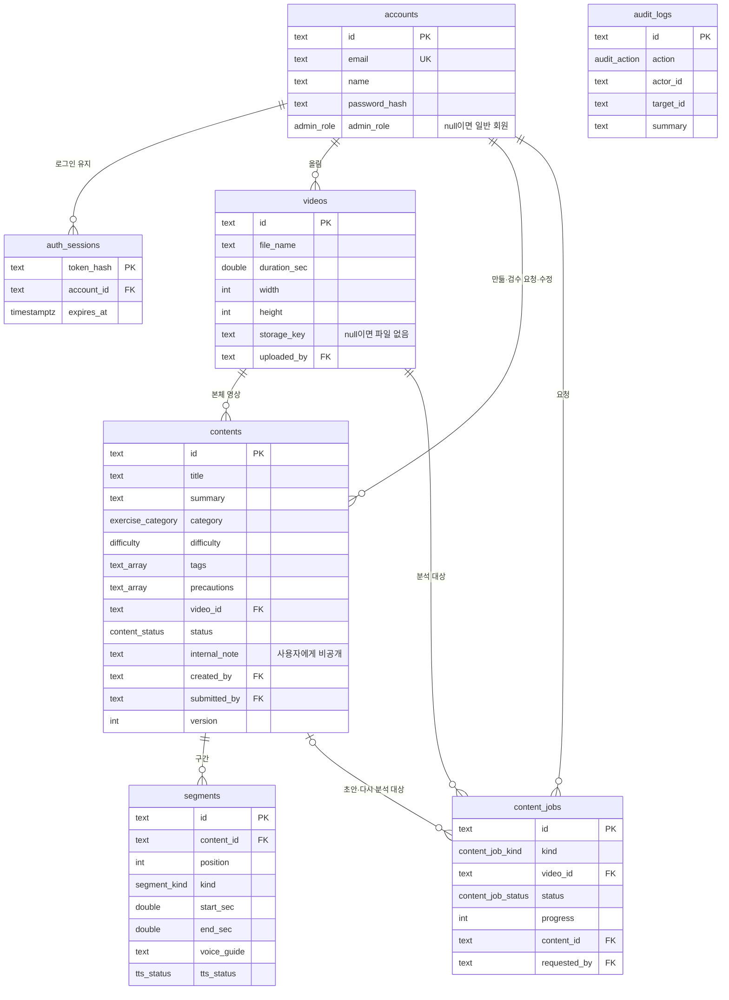

# 데이터베이스 설계

사용자 화면(`/`, `/exercises/{id}`, `/login`)과 관리자 화면(`/admin/...`)이 읽고 쓰는 데이터를 기준으로 설계했다.
테이블 정의 코드는 `packages/database/src/schema.ts`, 값의 종류(상태·역할 등)는 `@yconic/shared-types`와 같다.

- DB: PostgreSQL 18 (개발은 `pnpm db:start`, 서버는 `infrastructure/docker-compose.yml`)
- ORM·마이그레이션: Drizzle ORM / drizzle-kit (`packages/database/drizzle/`)

## 관계도

## 테이블

| 테이블 | 담는 것 | 쓰는 화면 |
| --- | --- | --- |
| `accounts` | 로그인 계정. 관리자는 `admin_role`(조회자·편집자·승인권자·최고 관리자)이 있고, 일반 회원은 비어 있다 | 로그인, 머리말의 이름, 관리자 권한 검사 |
| `auth_sessions` | 로그인 유지 토큰의 해시와 만료 시각 | 모든 로그인 상태 확인 |
| `videos` | 올린 영상의 정보(파일 이름, 길이, 해상도, 크기)와 저장소 위치 | 관리자 영상 올리기·교체, 사용자 운동 화면의 영상 |
| `contents` | 운동 콘텐츠: 제목, 요약, 분류, 난이도, 태그, 주의사항, 상태, 검수 의견, 내부 메모, 버전 | 관리자 목록·편집·검수, 사용자 운동 목록 |
| `segments` | 콘텐츠의 구간: 순서, 종류, 시작·끝 시각, 동작 설명, 음성 안내문, 음성 파일 상태 | 관리자 타임라인·구간 편집, 사용자 단계 카드·음성 안내 |
| `content_jobs` | AI 제작 작업: 종류(새 제작·다시 분석), 단계, 진행률, 실패 이유 | 관리자 AI 제작 작업, 대시보드 |
| `audit_logs` | 누가 언제 무엇을 했는지 | 관리자 감사 로그, 콘텐츠 이력 |

## 설계에서 정한 것

- **구간은 따로 테이블**로 둔다. 구간마다 음성 파일 생성 상태가 따로 바뀌고, 작업기가 구간 단위로 갱신하기 때문이다. `(content_id, position)`은 겹칠 수 없다.
- **음성 파일 상태(`tts_*`)는 서버만 바꾼다.** 관리자가 구간을 저장할 때 보낸 음성 상태는 무시하고, 기존 구간의 값을 유지한다. 새 구간은 "미생성"으로 시작한다.
- **버전(`version`)으로 동시 수정을 막는다.** 저장 요청의 `expectedVersion`이 다르면 409로 거절한다.
- **사용자에게 나가는 칸을 제한한다.** 사용자 API는 `status = PUBLISHED`인 콘텐츠만, 내부 메모·검수 의견·작성자 없이 내보낸다.
- **자기 승인 금지**를 위해 `submitted_by`를 둔다 (docs/decisions/0003).
- **영상 파일은 DB에 넣지 않는다.** DB에는 정보와 저장소 위치(`storage_key`)만 두고, 파일은 저장소에 둔다. 지금은 API 서버의 `apps/api/storage/videos`, 나중에 S3 호환 저장소로 바꾼다.
- **비밀번호와 토큰은 해시로만** 저장한다 (비밀번호 scrypt, 토큰 SHA-256).
- **감사 로그의 실행자는 계정 참조를 걸지 않는다.** AI 작업기(`content-worker`)도 기록을 남기기 때문이다.
- **ID는 문자열**이다. 예시 데이터의 ID(`c-neck` 등)를 그대로 쓰고, 새로 만드는 것은 서버가 `c-…`, `v-…`처럼 접두어가 붙은 무작위 값으로 만든다.

## 아직 넣지 않은 것

- 사용자의 운동 기록(운동 세션, 이력): 지금 화면이 저장하지 않는다. 사용자 이력 화면을 만들 때 `exercise_sessions` 테이블로 추가한다.
- "내 강의"(수강 정보, 짧은·자세한 안내문): 공통 타입 논의 후 추가한다.
- 벡터 검색(pgvector): 사용자 AI 에이전트를 만들 때 추가한다.
